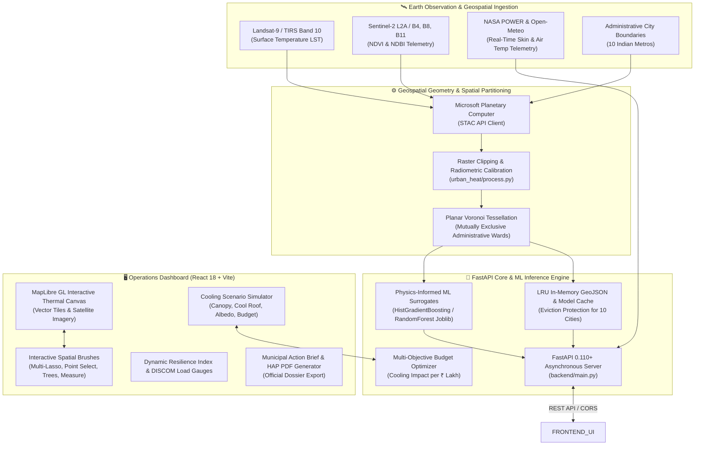

# UrbanIQ (v2.4 OPS) — National Urban Heat Decision Support System

> **Physics-Informed Climate Intelligence & Evidence-Based Heat Mitigation for Indian Metropolitan Municipalities**  
> *Pan-India Coverage: Pune (PMRDA), Mumbai (MMR), Delhi NCR, Bengaluru (BMRDA), Hyderabad (HMDA), Ahmedabad (AUDA), Chennai (CMDA), Kolkata (KMDA), Jaipur (JDA), Lucknow (LDA)*

[](https://fastapi.tiangolo.com)
[](https://react.dev/)
[](https://maplibre.org/)
[](https://scikit-learn.org/)
[](https://turfjs.org/)
[](https://www.python.org/)
[](https://www.docker.com/)

---

## 📌 Executive Overview

**UrbanIQ** is a production-ready, full-stack **Decision Support System (DSS)** engineered to help municipal commissioners, disaster management authorities, and urban planners mitigate the **Urban Heat Island (UHI)** effect across India.

Unlike conventional static dashboards that only display retrospective, descriptive satellite heatmaps, UrbanIQ provides **predictive and prescriptive decision intelligence**. It couples multi-spectral Earth Observation satellite feeds (Landsat-9 TIRS, Sentinel-2 L2A) and live NASA POWER radiometry with a **Physics-Informed Machine Learning surrogate** and an **administrative Voronoi spatial partition of 10 Indian metropolitan regions**. Municipal teams can simulate targeted interventions (cool roofs, urban afforestation, reflective pavements) and run budget optimization for maximum temperature reduction per rupee.

---

## 🏛️ System Architecture



---

## 🇮🇳 Multi-City Coverage (10 Indian Metros)

UrbanIQ natively hosts preprocessed GeoJSON ward partitions and trained physics-informed ML surrogates for 10 major Indian urban jurisdictions:

| City / Metropolitan Region | Jurisdiction | Administrative Zones | Baseline LST | Model Artifact |
|---|---|---|---|---|
| **Pune** | PMRDA / PMC | 31 Zones | $33.0^\circ\text{C}$ | `pune_rf_model.joblib` |
| **Mumbai** | MMR / BMC | 43 Zones | $32.5^\circ\text{C}$ | `mumbai_rf_model.joblib` |
| **Delhi NCR** | MCD / NCR Grid | 26 Zones | $34.0^\circ\text{C}$ | `delhi_rf_model.joblib` |
| **Bengaluru** | BBMP / BMRDA | 18 Zones | $31.0^\circ\text{C}$ | `bengaluru_rf_model.joblib` |
| **Hyderabad** | GHMC / HMDA | 15 Zones | $33.5^\circ\text{C}$ | `hyderabad_rf_model.joblib` |
| **Ahmedabad** | AMC / AUDA | 14 Zones | $35.0^\circ\text{C}$ | `ahmedabad_rf_model.joblib` |
| **Chennai** | GCC / CMDA | 12 Zones | $33.0^\circ\text{C}$ | `chennai_rf_model.joblib` |
| **Kolkata** | KMC / KMDA | 10 Zones | $33.2^\circ\text{C}$ | `kolkata_rf_model.joblib` |
| **Jaipur** | JMC / JDA | 8 Zones | $35.5^\circ\text{C}$ | `jaipur_rf_model.joblib` |
| **Lucknow** | LMC / LDA | 9 Zones | $34.5^\circ\text{C}$ | `lucknow_rf_model.joblib` |

---

## 💻 Tech Stack & Engineering Components

### 1. Frontend Operations UI (`frontend/`)
* **Framework:** React 18.3, Vite 8.1
* **Single Page Application Routing:** React Router v6 with `/* -> /index.html` rewrites (supports direct refreshes on `/map` and `/dashboard`).
* **Mapping Engine:** `@vis.gl/react-maplibre` + `maplibre-gl` (v5.1)
  * Hardware-accelerated WebGL vector tile rendering.
  * Seamless Basemap switching: Cartographic Light & Satellite Hybrid with true-north compass reorientation.
  * Contiguous administrative polygon fills with calibrated chromatic boundary strokes.
* **Client-side Geospatial Computation:** `@turf/turf` (v7.2) + Custom Even-Odd Ray Casting
  * **Freehand Multi-Lasso Tool:** Freehand loop drawing with non-blocking 2D ray casting that encircles and batches multiple wards simultaneously without map panning interference.
  * Spatial polygon centroid attribution and linear distance ruler.
  * Coordinate transformations and GeoJSON feature collection exports.
* **Design & Styling:** Tailwind CSS 3.4, PostCSS, Lucide React icons, Framer Motion.
* **Offline Resilience Mode:** Graceful client-side fallback with embedded baseline datasets whenever backend cold-starts.

### 2. Backend API & Spatial Pipeline (`backend/` & `src/urban_heat/`)
* **Web Framework:** FastAPI 0.110+, Uvicorn 0.28+ (ASGI)
* **Geospatial Processing:**
  * `geopandas` 0.14+ — Vector spatial data structures
  * `pyogrio` 0.7+ — C-accelerated GDAL/OGR vector reader
  * `shapely` 2.0+ — Geometric planar topological operations
  * `scipy.spatial.Voronoi` — Non-overlapping planar Dirichlet tessellation
  * `pyproj` 3.6+ — CRS reprojection (WGS84 `EPSG:4326` to localized UTM grids)
* **Data Serialization & Validation:** Pydantic v2 (Strict typing, JSON schema validation)
* **Optimization & Data Handling:** `pandas` 2.1+, `numpy` 1.26+, `pyyaml` 6.0, `joblib` 1.3+
* **Environment Configuration:** `python-dotenv` with dynamic host and cloud `$PORT` binding.

### 3. Machine Learning & Thermodynamic Surrogate
* **Algorithm:** `HistGradientBoostingRegressor` and `RandomForestRegressor` (Scikit-Learn 1.4+)
* **Input Feature Space:**
  * $\text{NDVI}$ (Normalized Difference Vegetation Index): Canopy moisture and transpiration
  * $\text{NDBI}$ (Normalized Difference Built-Up Index): Impervious concrete and structural density
  * Relative spatial Euclidean distance from municipal center ($\text{dist\_center\_km}$)
* **Thermodynamic Priors:** Enforces boundary layer thermodynamic monotonicity ($\partial\text{LST}/\partial\text{NDVI} \le 0$ and $\partial\text{LST}/\partial\text{NDBI} \ge 0$).

---

## 🎛️ Key Functional Features

### 1. Interactive Spatial Intervention Tools
* **Multi-Lasso Tool:** Freehand mouse drawing that loops around multiple wards on the map canvas, instantly selecting them for collective scenario simulation.
* **Point Select:** Click individual wards to inspect microclimate telemetry, population risk, and simulation deltas.
* **Plant Tree Tool:** Click coordinates on the map canvas to plant virtual urban tree canopies with cooling credit.
* **Green Area Tool:** Draw polygon boundaries representing planned urban parks ($+0.15\ \Delta\text{NDVI}$).
* **Linear Distance Ruler:** Measure Euclidean distances in kilometers across metropolitan sectors.
* **GeoJSON Export:** Exports planned interventions as GIS-standard `cooling_interventions.geojson`.

### 2. Multi-Layer Satellite GIS Telemetry
* **LST Surface Heat Layer:** Thermal Infrared satellite radiometry displaying Land Surface Temperature.
* **NDVI Canopy Layer:** Multi-spectral vegetation index illustrating canopy deficit.
* **Physics Heat Drivers:** Attribution circles identifying sensible heat flux and low albedo hot zones.
* **Vulnerable Demographics:** Population density and socio-economic heat exposure overlays.
* **DISCOM Grid Stress:** Electrical substation cooling draw tracking transformer brownout risk.

### 3. Cooling Scenario Simulator & Budget Optimizer
* Sliders for **Tree Canopy Target ($0 - 50\%$)**, **Cool Roof Coating ($0 - 100\%$)**, and **Reflective Pavement ($0 - 50\%$)**.
* Real-time calculation preview and dynamic **City Resilience Index Gauge**.
* **Targeted Ward Optimizer:** Evaluates only the active or lassoed wards, prioritizing CapEx allocation by cost efficiency ($\text{ROI in } ₹\text{ Lakhs per } ^\circ\text{C averted}$).

### 4. Official Heat Action Plan (HAP) PDF Export
* Generates an actionable, downloadable municipal action report (`.pdf`) with charts, executive recommendations, and DISCOM mitigation strategies ready for submission to state authorities.

---

## 🔌 API Reference

### Health & Readiness
| Method | Endpoint | Description |
|---|---|---|
| `GET` | `/` | API status, ready cities, and service catalog. |
| `GET` | `/health` | Instant container health probe (`{"status": "ok"}`). |
| `GET` | `/ready` | Readiness check confirming ready city models & datasets. |
| `GET` | `/cities` | Lists all operational cities across India. |

### Real-Time Telemetry & Geospatial Data
| Method | Endpoint | Description |
|---|---|---|
| `GET` | `/heatmap/{city}` | Retrieves processed ward GeoJSON FeatureCollection for `{city}`. |
| `GET` | `/telemetry/live/{city}` | Live satellite surface skin temp & 2m air temp via NASA & Open-Meteo. |
| `GET` | `/telemetry/nasa-status` | Status of NASA Earth Science radiometry gateway. |

### Physics-Informed ML Simulation
| Method | Endpoint | Description |
|---|---|---|
| `GET` | `/simulate` | Endpoint documentation and example payload schema. |
| `POST` | `/simulate` | Executes Physics-Informed ML simulation for specified zone IDs. |

#### Sample Simulation Request Payload:
```json
{
  "city": "pune",
  "zone_ids": ["PUN-01", "PUN-02"],
  "delta_ndvi": 0.15,
  "delta_ndbi": -0.10,
  "zone_deltas": {
    "PUN-01": { "delta_ndvi": 0.05, "delta_ndbi": -0.05 }
  }
}
```

---

## 🚀 Local Development Setup

### Prerequisites
* **Node.js** v18+ and `npm`
* **Python** 3.12+ (or Astral `uv`)

### 1. Backend Setup
```bash
# Navigate to project root
cd urban-IQ

# Create and activate Python 3.12 virtual environment using uv
uv venv --python 3.12
.venv\Scripts\activate    # Windows
# source .venv/bin/activate # Linux / macOS

# Install backend dependencies
uv pip install -r requirements.txt

# Start FastAPI development server
uvicorn backend.main:app --host 0.0.0.0 --port 8000 --reload
```
API Documentation will be live at: `http://localhost:8000/docs`

### 2. Frontend Setup
```bash
# In a new terminal window
cd urban-IQ/frontend

# Install dependencies
npm install

# Start Vite development server
npm run dev
```
Application will be live at: `http://localhost:5173`

---

## ☁️ Production Deployment

UrbanIQ is containerized and cloud-ready for single-click deployment via **Render Blueprint**:

### Render Blueprint Deployment (`render.yaml`)
The repository includes a production-validated `render.yaml` specification:
* `urban-heat-api` (Docker web service building the Python 3.12 FastAPI backend with dynamic `$PORT` and health checks).
* `urban-heat-frontend` (Static web service with automatic SPA rewrites to `/index.html` and public HTTPS backend resolution).

1. Connect `sanmitpatil07/urban-IQ` to [Render](https://dashboard.render.com).
2. Create a new **Blueprint Instance** and click **Apply**.
3. Render automatically provisions the Docker container and static frontend with zero manual configuration.

---

## 📁 Repository Structure

```text
urban-IQ/
├── backend/                         # FastAPI Application Core
│   ├── main.py                      # REST endpoints, CORS regex, multi-city LRU Cache
│   └── models.py                    # Pydantic schemas for simulation requests/responses
├── config/                          # Municipal configuration files
│   └── cities/pune.yaml             # Bounding box, CRS, and sensor configurations
├── data/                            # Processed GeoJSON Wards & Trained Models (10 Cities)
│   ├── ahmedabad/processed/         # Ahmedabad municipal zones & RF model
│   ├── bengaluru/processed/         # Bengaluru municipal zones & RF model
│   ├── chennai/processed/           # Chennai municipal zones & RF model
│   ├── delhi/processed/             # Delhi NCR municipal zones & RF model
│   ├── hyderabad/processed/         # Hyderabad municipal zones & RF model
│   ├── jaipur/processed/            # Jaipur municipal zones & RF model
│   ├── kolkata/processed/           # Kolkata municipal zones & RF model
│   ├── lucknow/processed/           # Lucknow municipal zones & RF model
│   ├── mumbai/processed/            # Mumbai MMR municipal zones & RF model
│   └── pune/processed/              # Pune PMRDA municipal zones & RF model
├── frontend/                        # React 18 + Vite Operations Dashboard
│   ├── public/                      # Static assets & SPA _redirects rule
│   ├── src/
│   │   ├── components/              # Gauges, Rails, Modals, TopNav, Overlays
│   │   ├── pages/
│   │   │   ├── LandingPage.jsx      # Public policy executive landing overview
│   │   │   └── MapView.jsx          # Mission Control WebGL GIS Map & Multi-Lasso
│   │   ├── utils/                   # PDF Report Generator & Ray-Casting Helpers
│   │   └── App.jsx                  # React Router routes (/map, /dashboard)
│   ├── package.json                 # Frontend dependencies
│   ├── tailwind.config.js           # Design tokens & color palette
│   └── vite.config.js               # Vite build configuration
├── src/urban_heat/                  # Core Geospatial Data Pipeline
│   ├── acquire.py                   # STAC satellite imagery ingestion
│   ├── boundary.py                  # Administrative boundary extraction
│   ├── model.py                     # Physics-Informed ML model wrapper
│   ├── process.py                   # Raster processing, LST, NDVI, NDBI computation
│   └── utils.py                     # CRS validation, path builders, structured logging
├── Dockerfile                       # Python 3.12 production container specification
├── render.yaml                      # Render Infrastructure-as-Code Blueprint
├── requirements.txt                 # Production Python dependencies (GDAL/Pyogrio/FastAPI)
└── README.md                        # Complete System Architecture & Documentation
```

---

## 📄 License & Attribution
* **License:** MIT License
* **Satellite Data Attribution:**
  * Landsat-9 courtesy of the U.S. Geological Survey (USGS).
  * Sentinel-2 data courtesy of the European Space Agency (ESA).
  * Ingested via Microsoft Planetary Computer STAC API.
  * Live skin surface radiometry powered by NASA POWER API and Open-Meteo.
* **Geographical Scope:** 10 Major Metropolitan Municipal Corporations across India.
