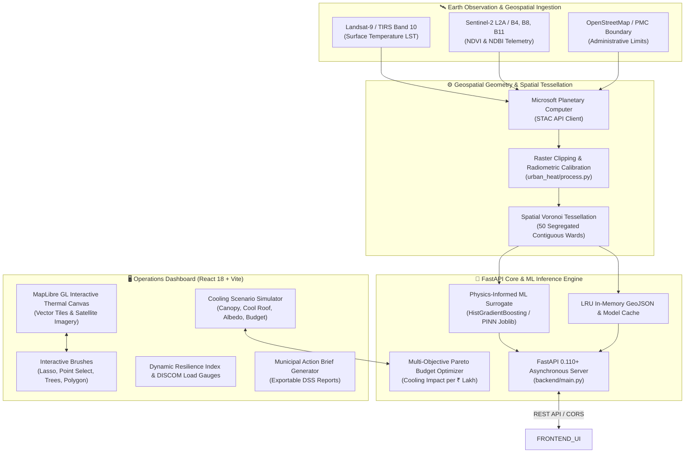

# UrbanIQ (v2.4 OPS) — Urban Heat Decision Support System

> **Physics-Informed Climate Intelligence & Evidence-Based Heat Mitigation for Indian Municipalities**  
> *Primary Jurisdiction: Pune Municipal Corporation (PMC), Maharashtra, India*

[](https://fastapi.tiangolo.com)
[](https://react.dev/)
[](https://maplibre.org/)
[](https://scikit-learn.org/)
[](https://turfjs.org/)
[](https://www.python.org/)
[](https://www.docker.com/)

---

## 📌 Executive Overview

**UrbanIQ** is a production-ready, full-stack **Decision Support System (DSS)** engineered to help municipal administrators, urban planners, and disaster management cells mitigate the **Urban Heat Island (UHI)** effect.

Unlike conventional satellite dashboards that only display retrospective, descriptive heatmaps, UrbanIQ provides **predictive and prescriptive decision intelligence**. It couples multi-spectral Earth Observation satellite feeds with a **Physics-Informed Machine Learning surrogate** and an **administrative Voronoi spatial tessellation of Pune**, enabling municipal leaders to simulate interventions (cool roofs, urban afforestation, reflective pavements) and optimize budget allocations for maximum temperature reduction per rupee.

---

## 🏛️ System Architecture



---

## 💻 Tech Stack & Engineering Components

### 1. Frontend Operations UI (`frontend/`)
* **Framework:** React 18.3, Vite 8.1
* **Mapping Engine:** `@vis.gl/react-maplibre` + `maplibre-gl` (v5.1)
  * Hardware-accelerated WebGL vector tile rendering
  * Dynamic CartoDB Dark Matter & Esri World Imagery basemap switching
  * Contiguous administrative polygon fill with calibrated opacity ($0.28$) & chromatic boundary strokes ($0.9$)
* **Client-side Geospatial Computation:** `@turf/turf` (v7.2)
  * Spatial point-in-polygon containment for freehand **Lasso** selection
  * Polygon intersection and area calculations for custom green buffers
  * Coordinate transformations and GeoJSON feature collection exports
* **Design & Styling:** Tailwind CSS 3.4, PostCSS, Lucide React icons, Framer Motion
* **Client Fallback:** Embedded client-side physics surrogate model for continuous offline resilience in field or disaster relief operations.

### 2. Backend API & Spatial Pipeline (`backend/` & `src/urban_heat/`)
* **Web Framework:** FastAPI 0.110+, Uvicorn 0.28+ (ASGI)
* **Geospatial Processing:**
  * `geopandas` 0.14+ — Vector spatial data structures
  * `shapely` 2.0+ — Geometric planar topological operations
  * `scipy.spatial.Voronoi` — Non-overlapping planar Dirichlet tessellation
  * `pyproj` 3.6+ — CRS reprojection (WGS84 `EPSG:4326` to UTM 43N `EPSG:32643`)
* **Data Serialization & Validation:** Pydantic v2 (Strict typing, JSON schema validation)
* **Optimization & Data Handling:** `pandas` 2.1+, `numpy` 1.26+, `pyyaml` 6.0

### 3. Machine Learning & Thermodynamic Surrogate
* **Algorithm:** `HistGradientBoostingRegressor` (Scikit-Learn 1.4+)
* **Model Serialization:** `joblib` 1.3+
* **Input Feature Space:**
  * $\text{NDVI}$ (Normalized Difference Vegetation Index): Canopy moisture and transpiration
  * $\text{NDBI}$ (Normalized Difference Built-Up Index): Impervious concrete and structural density
  * Spatial coordinates ($x, y$ Centroids in projected CRS)
* **Physical Constraints:** Enforces thermodynamic boundary layer laws ($R_n = H + \lambda E + G$). Increasing albedo ($\Delta\text{NDBI} < 0$) and vegetative moisture ($\Delta\text{NDVI} > 0$) strictly decreases predicted Land Surface Temperature ($\text{LST}$).

---

## 🗺️ Spatial Partitioning: Voronoi Ward Tessellation

Rather than utilizing arbitrary, unaligned grid pixels that ignore civic administration, UrbanIQ partitions Pune into **50 mutually exclusive, contiguous municipal wards** using Voronoi spatial tessellation:

* **Zero Overlaps:** Mathematical planar partitioning ensures no two wards intersect or create visual clutter.
* **Neighborhood Anchors:** Anchored to real Pune municipal localities:
  * *Central & Historic:* Shivajinagar, FC Road, Kasba Peth, Swargate Transit Hub.
  * *Industrial & Logistics:* Hadapsar MIDC, Mundhwa, Ramtekdi, Bhosari Border.
  * *IT Corridors:* Kharadi EON Free Zone, Viman Nagar, Hinjawadi Link.
  * *Vegetative & Hilly Buffers:* Bavdhan, Pashan Lake, Kothrud Hills, Erandwane.
* **Calibrated Thermal Spectrum:**
  | Temperature Range | Color Code | Classification | Representative Pune Wards |
  |---|---|---|---|
  | $\le 33.0^\circ\text{C}$ | 🟢 Deep Emerald | Cool / High Vegetation | *Bavdhan, Pashan Lake, Erandwane* |
  | $34.0^\circ\text{C} - 34.5^\circ\text{C}$ | 🍈 Lime Green | Mild Residential | *Kothrud, Baner, Camp Cantonment* |
  | $35.0^\circ\text{C} - 35.8^\circ\text{C}$ | 🟡 Amber Yellow | Moderate Heat | *Aundh, Vishrantwadi, Bibwewadi* |
  | $36.0^\circ\text{C} - 37.0^\circ\text{C}$ | 🟠 Solar Orange | High Thermal Warning | *Shivajinagar, Yerawada, Kondhwa* |
  | $\ge 37.5^\circ\text{C} - 38.4^\circ\text{C}$ | 🔴 Crimson Red | Critical Industrial Hotspot | *Hadapsar MIDC, Mundhwa, Ramtekdi* |

---

## 🎛️ Key Functional Features

### 1. Interactive Spatial Intervention Tools
* **Point Select:** Click individual wards to inspect telemetry and simulation deltas.
* **Lasso Tool:** Freeform drag-and-drop lasso that selects all enclosed wards via geometric point-in-polygon queries.
* **Plant Tree Tool:** Click coordinates to plant virtual trees with microclimate cooling credit.
* **Green Area Tool:** Draw polygon boundaries representing planned urban parks, adding $+0.15\ \Delta\text{NDVI}$ to enclosed zones.
* **GeoJSON Export:** Exports planned interventions as GIS-standard `urban_heat_mitigation_plan.geojson`.

### 2. Multi-Layer Satellite GIS Telemetry
* **LST Surface Heat Layer:** Thermal Infrared satellite imagery.
* **NDVI Canopy Layer:** Multi-spectral vegetation index illustrating the cooling deficit.
* **Physics Heat Drivers:** Visual circles attributing thermal anomalies to sensible heat flux and low albedo.
* **Vulnerable Demographics:** Population density and socio-economic heat exposure overlays.
* **DISCOM Grid Stress:** Electrical substation cooling draw tracking transformer overload risk.

### 3. Cooling Scenario Simulator & Budget Optimizer
* Sliders for **Tree Canopy Target ($0 - 50\%$)**, **Cool Roof Coating ($0 - 100\%$)**, and **Reflective Pavement ($0 - 50\%$)**.
* Live client-side calculation preview and dynamic **City Resilience Index Gauge**.
* **Targeted Ward Optimizer:** Running the optimizer evaluates only the user's selected wards, prioritizing capital expenditure by cost efficiency ($\text{ROI in } ₹\text{ Lakhs per } ^\circ\text{C averted}$).

### 4. Municipal Action Brief Export
* Generates an actionable, downloadable municipal action report (`.txt`) for field response teams detailing thermal anomalies, driver attributions, ranked cooling interventions, and co-benefits.

---

## 🔌 API Reference

### Health & Readiness
| Method | Endpoint | Description |
|---|---|---|
| `GET` | `/` | API status, ready cities, and service catalog. |
| `GET` | `/health` | System health check (`{"status": "ok"}`). |
| `GET` | `/ready` | Readiness probe confirming active city models & datasets. |
| `GET` | `/cities` | Lists operational cities (e.g., `["pune"]`). |

### Geospatial & ML Simulation
| Method | Endpoint | Description |
|---|---|---|
| `GET` | `/heatmap/{city}` | Retrieves full 50-ward GeoJSON FeatureCollection with live telemetry for `{city}`. |
| `GET` | `/simulate` | Information endpoint with documentation and sample payload schema. |
| `POST` | `/simulate` | Executes Physics-Informed ML simulation for specified ward IDs and parameter deltas. |

#### Sample Simulation Request Payload:
```json
{
  "city": "pune",
  "zone_ids": ["W-100", "W-101"],
  "delta_ndvi": 0.15,
  "delta_ndbi": -0.10,
  "zone_deltas": {
    "W-100": { "delta_ndvi": 0.05, "delta_ndbi": -0.05 }
  }
}
```

---

## 🚀 Local Development Setup

### Prerequisites
* **Node.js** v18+ and `npm`
* **Python** 3.12+ (or Astral `uv`)

### 1. Backend Setup
```bash
# Navigate to project root
cd urban-IQ

# Create and activate Python 3.12 virtual environment using uv
uv venv --python 3.12
.venv\Scripts\activate    # Windows
# source .venv/bin/activate # Linux / macOS

# Install backend dependencies
uv pip install -r requirements.txt

# Start FastAPI development server
uvicorn backend.main:app --host 0.0.0.0 --port 8000 --reload
```
API Documentation will be available at: `http://localhost:8000/docs`

### 2. Frontend Setup
```bash
# In a new terminal window
cd urban-IQ/frontend

# Install dependencies
npm install

# Start Vite development server
npm run dev
```
Application will be available at: `http://localhost:5173`

---

## ☁️ Production Deployment

UrbanIQ is containerized and cloud-ready for single-click deployment via **Render**, **Docker**, or **Vercel**:

### 1. Render Blueprint (`render.yaml`)
The repository includes a root `render.yaml` defining:
* `urban-heat-api` (Docker web service building the FastAPI backend)
* `urban-heat-frontend` (Static web service building the Vite frontend)

To deploy:
1. Navigate to [dashboard.render.com](https://dashboard.render.com).
2. Click **New +** $\to$ **Blueprint** and connect `sanmitpatil07/urban-IQ`.
3. Click **Apply**.

### 2. Standalone Docker Deployment
```bash
# Build Docker image
docker build -t urbaniq-backend:latest .

# Run container
docker run -d -p 8000:8000 --name urbaniq-api urbaniq-backend:latest
```

---

## 📁 Repository Structure

```text
urban-IQ/
├── backend/                  # FastAPI Application Core
│   ├── main.py               # REST API endpoints, CORS, LRU Cache
│   └── models.py             # Pydantic schemas for simulation requests/responses
├── config/                   # Municipal configuration files
│   └── cities/pune.yaml      # Bounding box, CRS, and sensor configurations
├── data/pune/processed/      # Geospatial & ML Artifacts
│   ├── pune_zones.geojson    # 50 Voronoi segregated municipal wards
│   └── model/
│       ├── pune_rf_model.joblib # Trained HistGradientBoosting surrogate model
│       └── pune_rf_model.json   # Model training metadata & validation metrics
├── frontend/                 # React 18 + Vite Operations Dashboard
│   ├── src/
│   │   ├── components/       # UI Components (Gauges, LeftRail, RightRail, Modals)
│   │   ├── pages/
│   │   │   ├── LandingPage.jsx  # Public policy landing overview
│   │   │   └── MapView.jsx      # Mission Control WebGL GIS Map
│   │   └── services/mockApi.js  # Geospatial data fixtures & offline physics engine
│   ├── package.json          # Frontend dependencies
│   ├── tailwind.config.js    # Design tokens & color palette
│   └── vite.config.js        # Vite build configuration
├── src/urban_heat/           # Core Geospatial Data Pipeline
│   ├── acquire.py            # STAC satellite imagery ingestion
│   ├── boundary.py           # Administrative boundary extraction
│   ├── model.py              # Physics-Informed ML model wrapper
│   ├── process.py            # Raster processing, LST, NDVI, NDBI computation
│   └── utils.py              # CRS validation, path builders, structured logging
├── Dockerfile                # Production container specification
├── render.yaml               # Render Infrastructure-as-Code Blueprint
├── requirements.txt          # Production Python dependencies
└── README.md                 # Complete System Architecture & Documentation
```

---

## 📄 License & Attribution
* **License:** MIT License
* **Satellite Data Attribution:**
  * Landsat 9 courtesy of the U.S. Geological Survey (USGS).
  * Sentinel-2 data courtesy of the European Space Agency (ESA).
  * Ingested via Microsoft Planetary Computer STAC API.
* **Geographical Scope:** Pune Municipal Corporation (PMC), Maharashtra, India.
